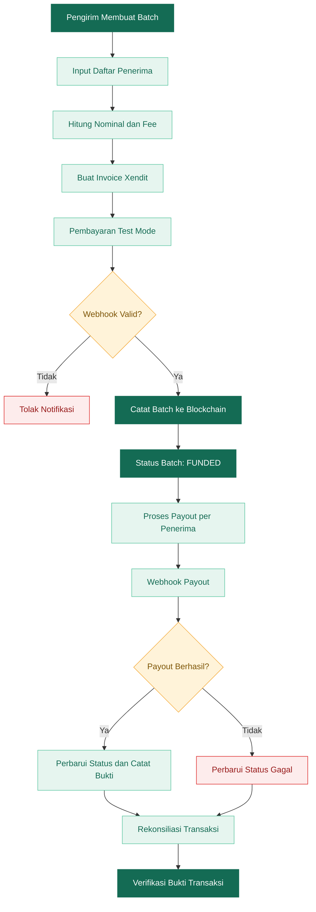
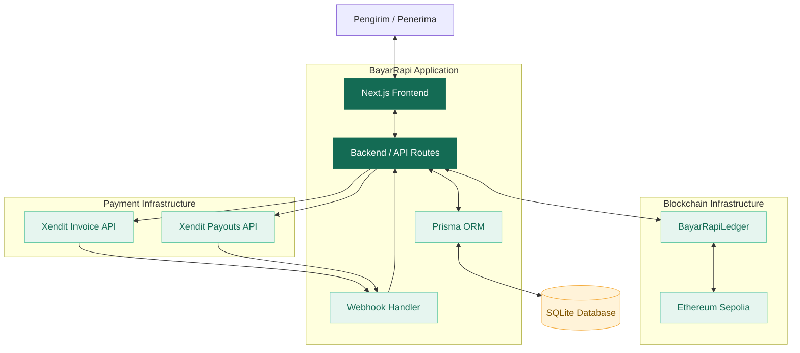
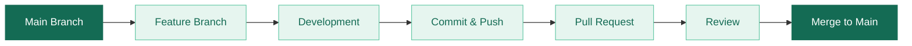

<div align="center">

  

  <h3>One Payment. Multiple Destinations.</h3>

  <p>
    <strong>Blockchain-Verified Payment Gateway</strong>
  </p>

  <p>
    Satu pembayaran, banyak penerima, dan bukti transaksi
    yang dapat diverifikasi melalui blockchain.
  </p>

  
  
  
  

  <br/>

  
  
  
  

  <br/><br/>

  <a href="#tentang">Tentang</a> •
  <a href="#fitur">Fitur</a> •
  <a href="#alur">Alur Transaksi</a> •
  <a href="#arsitektur">Arsitektur</a> •
  <a href="#instalasi">Instalasi</a> •
  <a href="#blockchain">Smart Contract</a> •
  <a href="#tim">Tim</a>

  <br/><br/>

  <sub>
    Tugas Akhir Teknologi Blockchain dan Platform Keuangan Dijital
    <br/>
    Fakultas Ilmu Komputer · Universitas Brawijaya · 2026
  </sub>

</div>

---

<a id="tentang"></a>

## 📖 Tentang BayarRapi

**BayarRapi** merupakan prototipe payment gateway yang
memungkinkan pengguna melakukan satu pembayaran untuk
mendistribusikan dana kepada beberapa penerima sekaligus,
dengan bukti transaksi yang dicatat melalui blockchain.

BayarRapi mengintegrasikan layanan pembayaran **Xendit**
dengan smart contract pada jaringan **Ethereum Sepolia**
untuk mendukung proses pembayaran, distribusi dana,
rekonsiliasi, dan verifikasi bukti transaksi.

### Permasalahan

Proses pengiriman dana kepada banyak penerima secara
terpisah dapat menimbulkan beberapa kendala:

- Proses transaksi yang berulang dan kurang efisien.
- Kesulitan memantau status setiap pengiriman dana.
- Rekonsiliasi transaksi yang membutuhkan pencatatan tambahan.
- Bukti transaksi yang bergantung pada sistem terpusat.

### Solusi BayarRapi

BayarRapi menggabungkan proses tersebut dalam satu sistem:

> **Pay once, distribute to many, verify on blockchain.**

Pengguna cukup membuat satu batch pembayaran, kemudian
sistem memproses distribusi dana dan mencatat bukti
transaksi yang dapat diverifikasi.

> [!IMPORTANT]
> BayarRapi merupakan prototipe untuk kebutuhan akademik.
> Seluruh transaksi menggunakan sandbox, test mode,
> testnet, dan data dummy. Tidak ada uang nyata,
> token bernilai, maupun data pribadi asli yang digunakan.

---

<a id="fitur"></a>

## ✨ Fitur Utama

| Fitur | Deskripsi |
| :--- | :--- |
| 💳 **Single Payment** | Satu pembayaran untuk beberapa penerima sekaligus. |
| 📦 **Batch Management** | Membuat dan mengelola daftar penerima dalam satu batch transaksi. |
| 🏦 **Multiple Payment Channels** | Integrasi pembayaran melalui VA, QRIS, dan e-wallet pada Xendit test mode. |
| 🔄 **Batch Payout** | Memproses distribusi dana kepada masing-masing penerima. |
| ⛓️ **Blockchain Ledger** | Mencatat hash batch dan bukti pencairan pada Ethereum Sepolia. |
| 🛡️ **Webhook Verification** | Memvalidasi notifikasi pembayaran dan mencegah pemrosesan notifikasi ganda. |
| 📊 **Reconciliation Report** | Menampilkan perhitungan dana masuk, dana terkirim, refund, dan biaya transaksi. |
| 🔍 **Proof Verification** | Memverifikasi bukti transaksi menggunakan kode bukti dan catatan on-chain. |
| 🧪 **Simulation Mode** | Menjalankan aplikasi secara lokal tanpa konfigurasi layanan eksternal. |

---

<a id="alur"></a>

## 🔄 Alur Transaksi



### Tahapan Pemrosesan

| Tahap | Proses | Keterangan |
| :---: | :--- | :--- |
| 01 | **Create Batch** | Pengirim memasukkan nama, bank, nomor rekening dummy, dan nominal penerima. |
| 02 | **Create Invoice** | Sistem menghitung total nominal dan fee, kemudian membuat invoice Xendit. |
| 03 | **Payment** | Pengirim menyelesaikan pembayaran melalui simulator Xendit. |
| 04 | **Verification** | Backend memverifikasi callback token, external ID, nominal, dan duplikasi notifikasi. |
| 05 | **On-chain Recording** | Hash daftar penerima dan total batch dicatat pada smart contract. |
| 06 | **Payout** | Backend mengirim payout menggunakan idempotency key per penerima. |
| 07 | **Status Update** | Webhook payout memperbarui status masing-masing penerima. |
| 08 | **Reconciliation** | Sistem menghitung dana terkirim, refund, dan fee. |
| 09 | **Proof Verification** | Penerima memeriksa bukti transaksi melalui kode bukti. |

---

<a id="arsitektur"></a>

## 🏗️ Arsitektur Sistem

BayarRapi mengintegrasikan aplikasi web, layanan pembayaran,
basis data, dan blockchain dalam satu arsitektur sistem.



### Komponen Sistem

| Komponen | Tanggung Jawab |
| :--- | :--- |
| **Frontend** | Antarmuka dashboard pengirim dan halaman verifikasi penerima. |
| **Backend** | Logika transaksi, pengelolaan batch, integrasi API, dan rekonsiliasi. |
| **Webhook Handler** | Menerima dan memvalidasi notifikasi dari Xendit. |
| **Database** | Menyimpan data operasional dan status transaksi. |
| **Smart Contract** | Mencatat hash batch dan bukti pencairan. |
| **Xendit** | Menyediakan layanan pembayaran masuk dan distribusi dana dalam test mode. |

---

## 🛠️ Technology Stack

<div align="center">

| Layer | Teknologi |
| :--- | :--- |
| Frontend |  |
| Backend |  |
| Language |  |
| Payment Gateway |  |
| Smart Contract |  |
| Blockchain |  |
| Contract Development |  |
| Database |  |
| ORM |  |

</div>

---

## 📁 Struktur Repository

```text
bayarrapi/
│
├── apps/
│   └── web/                    # Aplikasi Next.js
│
├── contracts/                  # Solidity dan Hardhat
│   └── README.md               # Dokumentasi smart contract
│
├── docs/                       # Dokumentasi proyek
│
├── assets/
│   └── logo-horizontal.png     # Identitas visual BayarRapi
│
├── BayarRapi.bat               # Launcher aplikasi Windows
├── Buat-Shortcut-Desktop.bat   # Pembuatan shortcut Desktop
│
└── README.md                   # Dokumentasi utama
```

| Direktori | Deskripsi |
| :--- | :--- |
| [`apps/web`](./apps/web) | Dashboard, API routes, webhook, dan halaman verifikasi penerima. |
| [`contracts`](./contracts) | Smart contract, kompilasi, pengujian, dan deployment. |
| [`docs`](./docs) | Dokumentasi pengembangan dan kebutuhan sistem. |
| [`assets`](./assets) | Logo dan aset visual proyek. |

---

<a id="instalasi"></a>

## 🚀 Getting Started

### Prasyarat

Pastikan perangkat telah memiliki:

- [Node.js](https://nodejs.org/) versi 20 atau lebih baru.
- [Git](https://git-scm.com/).
- npm sebagai package manager.

### 1. Clone Repository

```bash
git clone https://github.com/sugmamewingss/bayarrapi.git
cd bayarrapi
```

### 2. Pilih Metode Instalasi

<details open>
<summary><strong>🪟 Metode A — Quick Start Windows (Direkomendasikan)</strong></summary>

<br/>

BayarRapi menyediakan launcher otomatis untuk mempermudah
proses instalasi dan menjalankan aplikasi.

1. Buka folder utama repository.
2. Klik dua kali file `BayarRapi.bat`.
3. Tunggu proses instalasi dependensi dan persiapan database.
4. Server akan dijalankan dan browser akan terbuka otomatis.

Launcher menangani proses berikut:

- Instalasi dependensi aplikasi.
- Persiapan database lokal.
- Menjalankan development server.
- Membuka aplikasi melalui browser.

**Opsional:** Klik dua kali `Buat-Shortcut-Desktop.bat`
untuk membuat shortcut BayarRapi berikon logo pada Desktop.

> [!TIP]
> Metode ini cocok untuk pengguna yang ingin mencoba
> aplikasi tanpa menjalankan banyak perintah terminal.

</details>

<details>
<summary><strong>💻 Metode B — Instalasi Manual melalui Terminal</strong></summary>

<br/>

Masuk ke direktori aplikasi:

```bash
cd apps/web
```

Instal dependensi:

```bash
npm install
```

Salin konfigurasi environment.

Untuk Git Bash, Linux, atau macOS:

```bash
cp ../.env.example .env
```

Untuk Windows Command Prompt:

```cmd
copy ..\.env.example .env
```

Siapkan database:

```bash
npm run db:migrate
```

Jalankan aplikasi:

```bash
npm run dev
```

Buka aplikasi melalui:

**http://localhost:3000**

</details>

### 3. Akses Aplikasi

<div align="center">

[](http://localhost:3000)

<sub>Pastikan development server sudah berjalan.</sub>

</div>

---

## ⚙️ Environment Configuration

Konfigurasi layanan eksternal disimpan dalam file:

```text
apps/web/.env
```

Gunakan `.env.example` sebagai referensi konfigurasi.

| Environment Variable | Fungsi |
| :--- | :--- |
| `XENDIT_SECRET_KEY` | Autentikasi layanan Xendit test mode. |
| `OPERATOR_PRIVATE_KEY` | Menandatangani transaksi blockchain oleh operator. |
| `NGROK_DOMAIN` | Domain tunnel untuk menerima webhook Xendit. |

Lihat `.env.example` untuk daftar konfigurasi lengkap.

### Mode Operasional

| Kondisi | Perilaku Aplikasi |
| :--- | :--- |
| Tanpa `XENDIT_SECRET_KEY` | Aplikasi berjalan dalam mode simulasi. |
| Tanpa `OPERATOR_PRIVATE_KEY` | Pencatatan on-chain dinonaktifkan. |
| Konfigurasi Xendit test mode tersedia | Aplikasi menggunakan integrasi pembayaran sandbox. |
| Konfigurasi Sepolia tersedia | Pencatatan bukti transaksi dapat dilakukan on-chain. |
| `NGROK_DOMAIN` diisi | Launcher dapat membuka tunnel untuk webhook. |

> [!CAUTION]
> Jangan pernah memasukkan API key, callback token,
> private key, maupun kredensial lainnya ke repository.
> Simpan seluruh kredensial dalam file `.env` lokal.

---

<a id="blockchain"></a>

## ⛓️ Smart Contract & Blockchain

BayarRapi menggunakan smart contract **BayarRapiLedger**
pada jaringan Ethereum Sepolia untuk mencatat bukti
transaksi secara on-chain.

### Deployment Information

| Informasi | Detail |
| :--- | :--- |
| Contract Name | `BayarRapiLedger` |
| Network | Ethereum Sepolia |
| Network Type | Testnet |
| Chain ID | `11155111` |
| Language | Solidity |
| Development Framework | Hardhat |

**Contract Address**

```text
0x82C35E808366bd38D8d948359FCbC1a9776675DE
```

<div align="center">

[](https://sepolia.etherscan.io/address/0x82C35E808366bd38D8d948359FCbC1a9776675DE)

</div>

### Peran Blockchain

Blockchain digunakan sebagai lapisan pencatatan dan
verifikasi bukti transaksi, bukan sebagai media utama
pengiriman dana kepada rekening penerima.

- Mencatat hash daftar penerima.
- Mencatat total batch transaksi.
- Mencatat bukti pencairan.
- Mendukung verifikasi bukti transaksi secara on-chain.

Proses pembayaran dan distribusi dana tetap ditangani
melalui Xendit test mode.

### Compile & Test

Masuk ke direktori smart contract:

```bash
cd contracts
```

Instal dependensi:

```bash
npm install
```

Kompilasi smart contract:

```bash
npx hardhat compile
```

Jalankan pengujian:

```bash
npx hardhat test
```

Dokumentasi lebih lanjut tersedia pada
[`contracts/README.md`](./contracts/README.md).

---

## 🛡️ Security & Transaction Integrity

BayarRapi menerapkan mekanisme validasi untuk mendukung
integritas pemrosesan transaksi.

| Mekanisme | Tujuan |
| :--- | :--- |
| **Callback Token Verification** | Memvalidasi autentisitas webhook melalui `x-callback-token`. |
| **External ID Validation** | Memastikan notifikasi berkaitan dengan transaksi yang sesuai. |
| **Amount Validation** | Memastikan nominal pembayaran sesuai dengan invoice. |
| **Duplicate Notification Handling** | Mencegah pemrosesan ulang notifikasi yang sama. |
| **Idempotency Key** | Mencegah pengiriman payout ganda untuk item yang sama. |
| **On-chain Hash** | Mendukung pemeriksaan integritas bukti transaksi. |
| **Environment Isolation** | Memisahkan konfigurasi rahasia dari source code. |

> [!NOTE]
> Mekanisme tersebut merupakan bagian dari rancangan
> prototipe dan tidak menyatakan bahwa aplikasi telah
> melalui audit keamanan untuk penggunaan produksi.

---

## 📊 Rekonsiliasi Transaksi

BayarRapi menyediakan laporan rekonsiliasi untuk
memastikan aliran dana dapat ditelusuri.

Persamaan rekonsiliasi akhir:

```text
Dana Masuk = Dana Terkirim + Refund + Fee Berhasil
```

Keterangan:

| Komponen | Deskripsi |
| :--- | :--- |
| **Dana Masuk** | Total pembayaran yang diterima dari pengirim. |
| **Dana Terkirim** | Total nominal payout yang berhasil diproses. |
| **Refund** | Nominal dan fee transfer yang gagal. |
| **Fee Berhasil** | Biaya dari transfer yang berhasil diproses. |

Persamaan tersebut digunakan untuk rekonsiliasi akhir
setelah seluruh item payout memperoleh status akhir.

---

## 📚 Dokumentasi

Dokumentasi pengembangan tersedia pada direktori
[`docs`](./docs).

| Dokumentasi | Keterangan |
| :--- | :--- |
| **Log Ide** | Riwayat dan dasar pengembangan konsep BayarRapi. |
| **User Stories** | Kebutuhan pengguna dan skenario penggunaan. |
| **ERD** | Struktur entitas dan relasi basis data. |
| **System Architecture** | Rancangan arsitektur dan integrasi sistem. |
| **API Documentation** | Dokumentasi antarmuka layanan aplikasi. |
| **AI Declaration** | Pernyataan penggunaan AI dalam pengembangan proyek. |
| **Smart Contract** | Dokumentasi implementasi blockchain. |

<div align="center">

[](./docs)

[](./contracts/README.md)

</div>

---

## 🤝 Contribution Guidelines

Pengembangan BayarRapi dilakukan secara kolaboratif
dengan menggunakan Git dan GitHub.

### Development Workflow



### Aturan Pengembangan

1. Jangan melakukan commit kredensial atau API key.
2. Gunakan satu branch untuk setiap fitur.
3. Gabungkan perubahan melalui Pull Request.
4. Gunakan akun GitHub masing-masing anggota.
5. Gunakan pesan commit yang jelas dan konsisten.
6. Lakukan pengujian sebelum menggabungkan perubahan.

### Branch Naming

```text
feat/<nama-fitur>
fix/<nama-perbaikan>
docs/<nama-dokumentasi>
test/<nama-pengujian>
```

### Commit Convention

| Prefix | Penggunaan |
| :--- | :--- |
| `feat:` | Penambahan fitur baru. |
| `fix:` | Perbaikan bug. |
| `docs:` | Perubahan dokumentasi. |
| `chore:` | Pemeliharaan dan konfigurasi proyek. |
| `test:` | Penambahan atau perubahan pengujian. |
| `refactor:` | Penyempurnaan struktur kode. |

Contoh:

```bash
git checkout -b feat/batch-payment
git add .
git commit -m "feat: implement batch payment"
git push -u origin feat/batch-payment
```

Setelah itu, buat Pull Request menuju branch `main`.

---

## 📈 Project Activity

<div align="center">

[](https://github.com/sugmamewingss/bayarrapi/graphs/contributors)

[](https://github.com/sugmamewingss/bayarrapi/commits/main)

[](https://github.com/sugmamewingss/bayarrapi/issues)

[](https://github.com/sugmamewingss/bayarrapi/pulls)

[](https://github.com/sugmamewingss/bayarrapi)

</div>

---

## ❓ Frequently Asked Questions

<details>
<summary><strong>Apakah BayarRapi menggunakan uang nyata?</strong></summary>

<br/>

Tidak. BayarRapi menggunakan Xendit sandbox/test mode
dan Ethereum Sepolia untuk kebutuhan simulasi akademik.

</details>

<details>
<summary><strong>Apakah aplikasi dapat dijalankan tanpa API key?</strong></summary>

<br/>

Ya. Tanpa konfigurasi Xendit, aplikasi berjalan dalam
mode simulasi. Pencatatan blockchain juga dinonaktifkan
apabila konfigurasi operator tidak tersedia.

</details>

<details>
<summary><strong>Apakah dana dikirim melalui blockchain?</strong></summary>

<br/>

Tidak. Distribusi dana diproses melalui Xendit Payouts API
dalam test mode. Blockchain digunakan untuk mencatat
dan memverifikasi bukti transaksi.

</details>

<details>
<summary><strong>Apakah seluruh data penerima disimpan di blockchain?</strong></summary>

<br/>

Rancangan BayarRapi menggunakan hash daftar penerima
sebagai bagian dari pencatatan batch, bukan menyimpan
seluruh daftar penerima secara langsung.

</details>

<details>
<summary><strong>Mengapa menggunakan Ethereum Sepolia?</strong></summary>

<br/>

Sepolia merupakan jaringan pengujian Ethereum yang
memungkinkan pengembangan dan pengujian smart contract
tanpa menggunakan aset bernilai nyata.

</details>

<details>
<summary><strong>Bagaimana cara memeriksa bukti transaksi?</strong></summary>

<br/>

Penerima dapat menggunakan halaman verifikasi dengan
memasukkan kode bukti untuk mencocokkan transaksi
dengan catatan on-chain yang tersedia.

</details>

<details>
<summary><strong>Apakah BayarRapi siap digunakan untuk produksi?</strong></summary>

<br/>

Belum. BayarRapi merupakan prototipe akademik yang
dikembangkan untuk mendemonstrasikan integrasi payment
gateway dan teknologi blockchain.

</details>

---

<a id="tim"></a>

## 👥 Development Team

<div align="center">

### Kelompok 3

**Teknologi Blockchain dan Platform Keuangan Dijital**

Fakultas Ilmu Komputer — Universitas Brawijaya

| No. | Nama | NIM |
| :---: | :--- | :--- |
| 01 | Alfi Perdiansyah Putra | 245150701111028 |
| 02 | Muhammad Farhan Muzakkiy | 245150707111048 |
| 03 | Mukhamad Irfan Nur Khakim | 245150701111021 |
| 04 | Rakapaksi Satrya Putra | 245150701111034 |

</div>

---

## 🔗 Resources

- [Next.js Documentation](https://nextjs.org/docs)
- [TypeScript Documentation](https://www.typescriptlang.org/docs/)
- [Xendit Documentation](https://docs.xendit.co/)
- [Ethereum Documentation](https://ethereum.org/developers/docs/)
- [Solidity Documentation](https://docs.soliditylang.org/)
- [Hardhat Documentation](https://hardhat.org/docs)
- [Prisma Documentation](https://www.prisma.io/docs)
- [Sepolia Etherscan](https://sepolia.etherscan.io/)

---

<div align="center">

  

  <h3>Pay Simply. Distribute Efficiently. Verify Transparently.</h3>

  <p>
    Developed by <strong>Kelompok 3</strong>
    <br/>
    Fakultas Ilmu Komputer · Universitas Brawijaya
    <br/>
    2026
  </p>

  <a href="https://github.com/sugmamewingss/bayarrapi">
    
  </a>

  <br/><br/>

  <a href="#tentang">↑ Back to Top</a>

  <br/><br/>

  <sub>
    Built for educational purposes.
    All transactions are simulated using sandbox and testnet.
  </sub>

</div>
