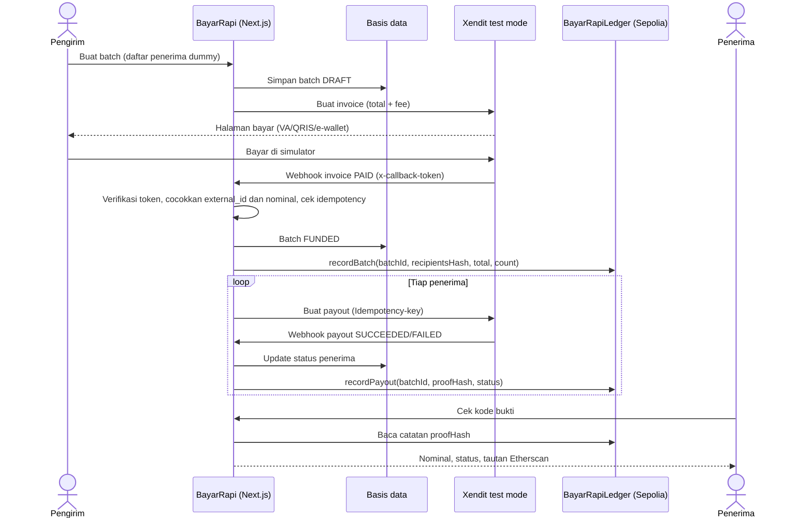

# Arsitektur Sistem (draf awal)

Penanggung jawab: Irfan.

## Kenapa blockchain

Pengirim bisa saja mengubah data di basis data sendiri. Catatan on-chain membuat alokasi dan status pencairan per penerima tidak bisa diubah setelah dicatat, dan penerima bisa memeriksanya tanpa akses ke dashboard pengirim.

Batasan yang harus diakui: blockchain tidak membuktikan bahwa uang benar-benar masuk ke rekening penerima. Sumber kebenaran status tetap Xendit. Blockchain hanya membuktikan bahwa catatan tidak diubah sejak ditulis.
