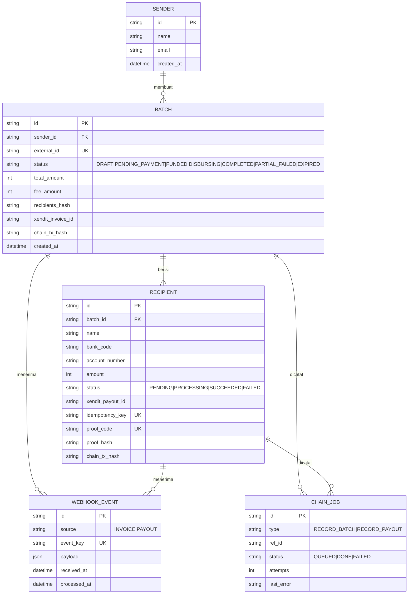

# ERD (draf awal)

Penanggung jawab: Farhan. Draf ini titik awal dan boleh diubah.

Catatan:
- Nama dan nomor rekening penerima hanya di basis data, tidak pernah ke blockchain.
- `event_key` unik dipakai untuk idempotency webhook.
- `proof_code` diberikan ke penerima; `proof_hash` = `keccak256(batch_id, recipient_id, amount, salt)` yang dicatat on-chain.
